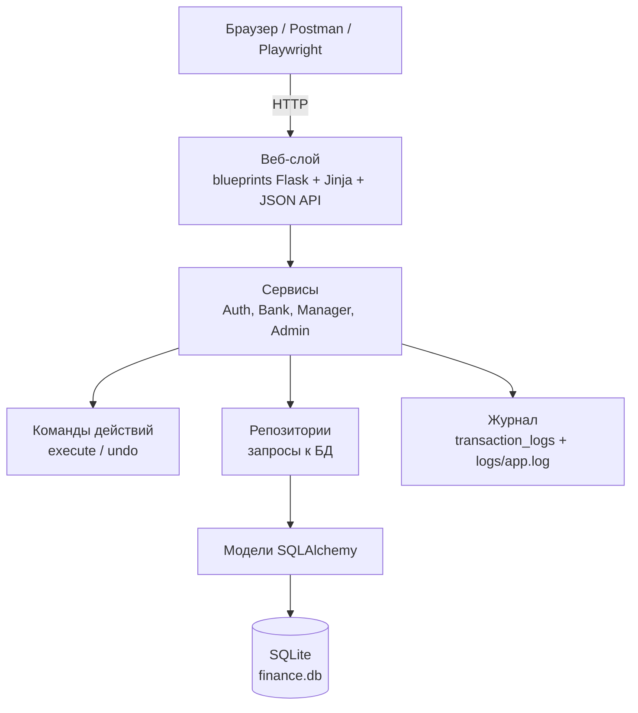

# Управление финансовой системой

Веб-приложение для частного клиента и сотрудников банка: счета и вклады в разных банках, переводы между ними, зарплатные проекты предприятий, подтверждение операций менеджером, журнал действий и их отмена администратором.

Учебный проект: одна кодовая база используется как база для пяти лабораторных по верификации ПО (требования → тесты → план и кейсы → UI/API → нагрузка).

> **Изучаешь проект с нуля?** Начни с [`СДАЧА.md`](СДАЧА.md) — это оглавление.
> Шесть гайдов лежат в [`readmes/`](readmes/): план на 2–3 часа и по одному файлу на каждую лабораторную.
> Документы для сдачи — в [`docs/`](docs/README.md) по папкам `lab1`…`lab5`.

## 1. Назначение и целевые пользователи

**Проблема.** Клиенту, у которого счета в нескольких банках, неудобно переводить деньги между ними и получать зарплату: каждый банк — отдельное приложение. Банку нужен контроль: кто открыл счёт, какие операции прошли, что можно отменить.

**Цель.** Одна точка входа, где клиент сам открывает счёт или вклад, переводит средства, подаёт заявку на зарплатный проект и видит историю; менеджер подтверждает клиентов и заявки, блокирует счета; администратор видит весь журнал и отменяет ошибочные операции.

| Роль | Что делает |
|---|---|
| **Клиент** | Регистрируется (ждёт подтверждения), открывает счёт/вклад, переводит средства, копит проценты по вкладу, подаёт заявку на зарплатный проект и получает зарплату, смотрит историю |
| **Менеджер** | Подтверждает или отклоняет регистрации и заявки, ведёт предприятия и штат, блокирует/разблокирует счета, смотрит историю клиента |
| **Администратор** | Видит журнал всех действий, отменяет ошибочные операции |

## 2. Стек технологий

| Слой | Технология |
|---|---|
| Язык | Python 3.10+ |
| Веб-фреймворк | Flask 3 (blueprints, app factory) |
| Шаблоны | Jinja2 + HTML/CSS (без JS-фреймворков) |
| Доступ к данным | SQLAlchemy 2 + Flask-SQLAlchemy (ORM, репозитории) |
| СУБД | SQLite (файл `finance.db`) |
| Тесты | pytest, pytest-cov; браузерные — Playwright (Page Object) |
| Нагрузка | Locust |
| Линтер | ruff |
| API-тесты | Postman (коллекция в `docs/lab4/postman/`) |

## 3. Архитектура

Четыре слоя, зависимости идут только вниз: представление → сервисы → репозитории → модели.



Правила, которые держат слои раздельно:

1. Обработчик маршрута не пишет SQL и не меняет модели — он вызывает сервис и рендерит шаблон.
2. Сервис отвечает за бизнес-правило (достаточно ли средств, чей счёт, можно ли отменить), репозиторий — только за выборку и сохранение.
3. Модель не знает ни про Flask, ни про HTTP.
4. Каждая изменяющая операция пишет запись в журнал и, если её можно отменить, имеет команду с `undo`.

## 4. Модули

| Модуль | Ответственность |
|---|---|
| `app.py` | Фабрика приложения: конфигурация, регистрация blueprints, обработчики ошибок, запуск |
| `config.py` | Настройки: строка подключения к БД, секретный ключ, режим отладки |
| `extensions.py` | Объект `db` (Flask-SQLAlchemy), общий для приложения и тестов |
| `models.py` | Сущности: `User`, `Bank`, `Enterprise`, `Employment`, `Account`, `TransactionLog`, `SalaryRequest`; статусы и типы |
| `repositories/account_repository.py` | Выборка счетов пользователя, по id, изменение баланса, блокировка |
| `repositories/user_repository.py` | Пользователи: создание, поиск по логину/id, ожидающие подтверждения |
| `repositories/bank_repository.py`, `enterprise_repository.py` | Справочники банков и предприятий |
| `services/auth_service.py` | Регистрация (только клиент), проверка пароля по хэшу, вход/выход |
| `services/bank_service.py` | Открытие/закрытие счёта, перевод, вклад и начисление, заявка на зарплату, получение зарплаты, история |
| `services/manager_service.py` | Подтверждение и отклонение регистраций и заявок, предприятия и штат, блокировка счетов |
| `services/admin_service.py` | Журнал всех действий, отмена операции через команду |
| `services/commands.py` | Классы действий с `execute()`/`undo()` — отмена без `if/elif` |
| `web/auth.py` | Blueprint `/login`, `/register`, `/logout` |
| `web/client.py` | Blueprint страниц клиента: счета, вклады, переводы, история, зарплата |
| `web/manager.py` | Blueprint страниц менеджера |
| `web/admin.py` | Blueprint страниц администратора |
| `web/api.py` | JSON API `/api/v1/...` с токеном — для Postman и нагрузочных прогонов |
| `templates/`, `static/` | Jinja-шаблоны (базовый + страницы по ролям) и CSS |
| `tests/unit`, `tests/integration`, `tests/scenario`, `tests/ui` | Юнит с моками, интеграционные на БД, сценарные переходы состояний, браузерные тесты |
| `load/locustfile.py` | Профиль нагрузки и сценарии Locust |
| `docs/lab4/postman/` | Коллекция и окружение Postman на все эндпоинты API |
| `tools/` | Скрипты отчётности: скриншоты, кроссбраузерность, безопасность, сборка коллекции |
| `docs/` | Спецификация требований, диаграмма состояний, тест-план, отчёты |
| `ui/` | Архивный слой на `customtkinter` — в веб-версии не используется, оставлен как история проекта |

## 5. Точки интеграции

| Точка | Что именно | Где настроено |
|---|---|---|
| **База данных** | SQLite-файл `finance.db`, 7 таблиц: `users`, `banks`, `enterprises`, `employment`, `accounts`, `salary_requests`, `transaction_logs` | `config.py` → `SQLALCHEMY_DATABASE_URI` |
| **HTTP API** | `/api/v1/...` — вход по токену, счета, переводы, история; используется Postman и Locust | `web/api.py` |
| **Файловая система** | `finance.db` (данные), `logs/app.log` (журнал приложения), `screenshots/` (скриншоты браузерных тестов) | `config.py`, `tests/ui/conftest.py` |
| **Внешних сервисов нет** | Платежи, проценты и подтверждения моделируются внутри системы; сетевые вызовы только в тестовых инструментах | — |

## 6. Сборка и запуск

```bash
python -m venv .venv
.venv\Scripts\activate          # Windows
source .venv/bin/activate       # Linux / macOS

pip install -r requirements.txt
python seed.py                  # демо-данные: банки, предприятия, три учётные записи
flask --app app run --debug     # http://127.0.0.1:5000
```

Демо-учётные записи создаёт `seed.py`: `client1` / `client1`, `manager1` / `manager1`, `admin1` / `admin1`.

| Задача | Команда |
|---|---|
| Тесты | `pytest` |
| Покрытие | `pytest --cov --cov-report=term-missing --cov-report=html` |
| Браузерные тесты | `pytest -m ui` (нужен `playwright install chromium`) |
| Те же тесты в другом браузере | `UI_BROWSER=firefox pytest -m ui`, `UI_BROWSER=webkit pytest -m ui` |
| Нагрузка | `locust -f load/locustfile.py` |
| Линтер | `ruff check .` |
| Матрица кроссбраузерности | `python tools/cross_browser_check.py` → `docs/lab4/COMPATIBILITY.md` |
| Проверки безопасности | `python tools/security_check.py` → `docs/lab4/SECURITY.md` |
| Скриншоты для отчёта | `python tools/capture_screenshots.py` |
| API-коллекция и отчёт | `newman run docs/lab4/postman/FinanceSystem.postman_collection.json -e docs/lab4/postman/local.postman_environment.json` |

Перед браузерными тестами один раз выполните `playwright install chromium` (на Windows этого
достаточно). В WSL без root браузеру нужны системные библиотеки — `sudo playwright install-deps`
или запуск тестов из Windows.
| Нагрузка и отчёт | `locust -f load/locustfile.py --headless -u 20 -r 20 -t 20s --host http://127.0.0.1:5005`, затем `python tools/load_report.py` |

## 7. Документация

| Документ | Содержание |
|---|---|
| [`docs/lab1/SRS_finance.md`](docs/lab1/SRS_finance.md) | Бизнес-требования, 5 use case, 16 функциональных и 6 нефункциональных требований, способ проверки каждого |
| [`docs/lab1/STATE_DIAGRAM.md`](docs/lab1/STATE_DIAGRAM.md) | Диаграммы состояний заявки на зарплатный проект и счёта |
| [`ISSUES.md`](docs/lab1/ISSUES.md) | Реестр дефектов: ожидаемый/фактический результат, шаги, важность, срочность |
| [`docs/lab3/TEST_PLAN.md`](docs/lab3/TEST_PLAN.md) | План тестирования: цели, области, стратегия, критерии, метрики |
| [`docs/lab3/CHECKLIST.md`](docs/lab3/CHECKLIST.md) | Чек-лист по всем FR: позитивные и негативные проверки |
| [`docs/lab3/TEST_CASES.md`](docs/lab3/TEST_CASES.md) | 52 тест-кейса с атрибутами и шагами |
| [`docs/lab3/TEST_RESULTS.md`](docs/lab3/TEST_RESULTS.md) | Результаты прогона, метрики, скриншоты |
| [`docs/lab3/DEFECT_REPORTS.md`](docs/lab3/DEFECT_REPORTS.md) | Отчёты о дефектах |
| [`docs/lab4/COMPATIBILITY.md`](docs/lab4/COMPATIBILITY.md) | Матрица кроссбраузерности и проверки вёрстки |
| [`docs/lab4/API_TESTING.md`](docs/lab4/API_TESTING.md) | Postman-коллекция, связывание токена, отчёт прогона |
| [`docs/lab4/SECURITY.md`](docs/lab4/SECURITY.md) | Проверки доступа, IDOR, ошибок и логирования |
| [`docs/lab5/LOAD_PLAN.md`](docs/lab5/LOAD_PLAN.md), [`docs/lab5/LOAD_RESULTS.md`](docs/lab5/LOAD_RESULTS.md) | План нагрузочного тестирования и результаты с графиком |
| [`docs/lab5/LINTING.md`](docs/lab5/LINTING.md) | Статическая проверка кода: что нашёл и что исправлено |
| [`docs/lab5/TRACEABILITY.md`](docs/lab5/TRACEABILITY.md) | Матрица трассируемости: требования ↔ тесты ↔ дефекты |
| [`СДАЧА.md`](СДАЧА.md) | Оглавление гайдов: план и пять файлов по лабораторным |
| [`readmes/`](readmes/) | Гайды для изучения: план, ЛР1…ЛР5 |
| [`docs/README.md`](docs/README.md) | Что лежит в папках `lab1`…`lab5` |
| [`docs/_internal/BLOCKS.md`](docs/_internal/BLOCKS.md) | Журнал изменений по блокам |
| [`AUDIT.md`](docs/_internal/AUDIT.md) | Разведка перед переносом на Flask |
