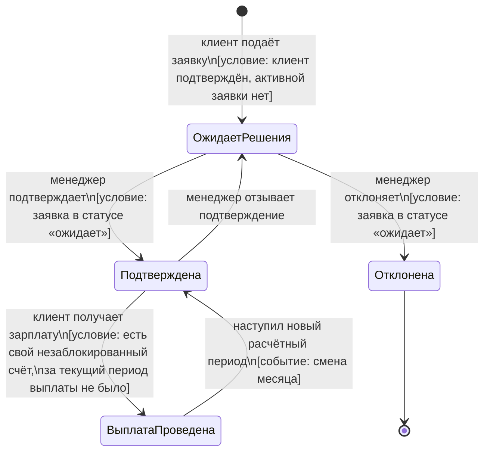
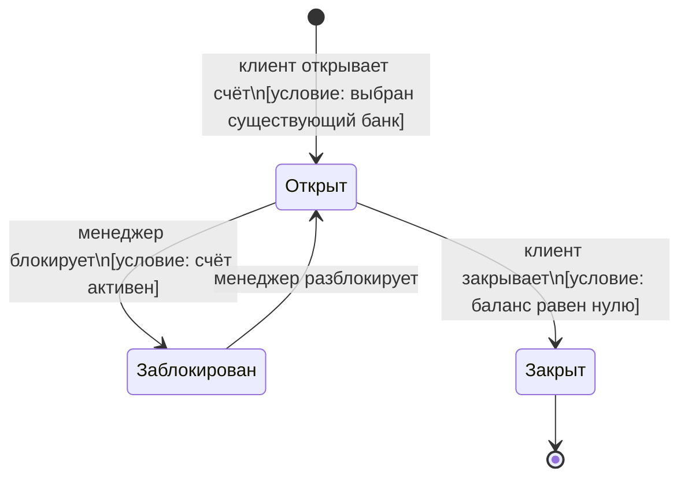

# Диаграмма состояний (ЛР1 п. 4)

Задание: выбрать сущность с жизненным циклом, показать начальное и конечное состояния, события и условия на переходах. В системе две сущности с настоящим жизненным циклом; главная — заявка на зарплатный проект, вторая — счёт.

## 1. Заявка на зарплатный проект

**Начальное состояние:** заявки нет; переход в «Ожидает решения» создаёт её.
**Конечное состояние:** «Отклонена» — заявка закрыта, повторная подача создаёт новую заявку.

**События:** подача заявки, решение менеджера (подтвердить/отклонить), получение зарплаты, смена периода, отзыв подтверждения.
**Условия на переходах:** клиент подтверждён; активной заявки нет; заявка в статусе «ожидает»; есть свой незаблокированный счёт; выплаты за период ещё не было.

| Переход | Событие | Условие | Действие | Где в коде |
|---|---|---|---|---|
| — → Ожидает решения | клиент подаёт заявку | клиент подтверждён, нет активной заявки | создать заявку со статусом `pending` | `BankService.apply_for_salary` |
| Ожидает решения → Подтверждена | менеджер подтверждает | статус `pending` | статус `approved`, запись в `employment`, журнал | `ManagerService.approve_salary_project` |
| Ожидает решения → Отклонена | менеджер отклоняет | статус `pending` | статус `rejected`, журнал | `ManagerService.reject_salary_project` |
| Подтверждена → Выплата проведена | клиент получает зарплату | есть незаблокированный счёт, за период не платили | зачисление, `last_paid_at` = сейчас, журнал | `BankService.pay_salary` |
| Выплата проведена → Подтверждена | наступил новый месяц | `last_paid_at` в прошлом периоде | выплата снова доступна | `BankService.pay_salary` (проверка периода) |
| Подтверждена → Ожидает решения | менеджер отзывает | статус `approved` | статус `pending` | `ManagerService.revoke_salary_project` |

**Запрещённый переход:** повторная выплата в том же периоде. Это не отдельное состояние, а ограничение операции — проверяется в сервисе и покрывается негативным тест-кейсом («получить зарплату дважды подряд»).

## 2. Счёт клиента

**Начальное:** счёта нет. **Конечное:** «Закрыт», обратного перехода нет.
**Ключевые условия:** закрыть можно только при нулевом балансе; закрыть заблокированный счёт нельзя — сначала менеджер разблокирует; закрыть чужой счёт нельзя (проверка владельца).

**Запрещённые операции (не состояния, а ограничения):** перевод **с** заблокированного счёта; перевод на заблокированный счёт; закрытие чужого счёта. Проверяются в сервисе, покрываются негативными тестами FR-7, FR-9, FR-14, NFR-5.

## 3. Как показывать на защите

1. Открыть файл, показать диаграмму заявки.
2. Сказать: «начальное состояние — заявки нет; конечное — отклонена; на переходах — пять событий и условия в квадратных скобках».
3. Показать в коде места переходов: `apply_for_salary` (подача), `approve_salary_project` / `reject_salary_project` (решение), `pay_salary` (выплата), `revoke_salary_project` (отзыв).
4. На вопрос «почему повторная выплата не нарисована отдельным состоянием» — ответ: «это ограничение операции, а не состояние сущности; оно проверяется в сервисе и покрыто негативным тест-кейсом».

## 4. Чего в диаграмме намеренно нет

- Полей и таблиц — диаграмма состояний описывает поведение, а не данные.
- Таймеров и отложенных переходов — в задании не требуется.
- Состояний интерфейса — это не жизненный цикл сущности.
