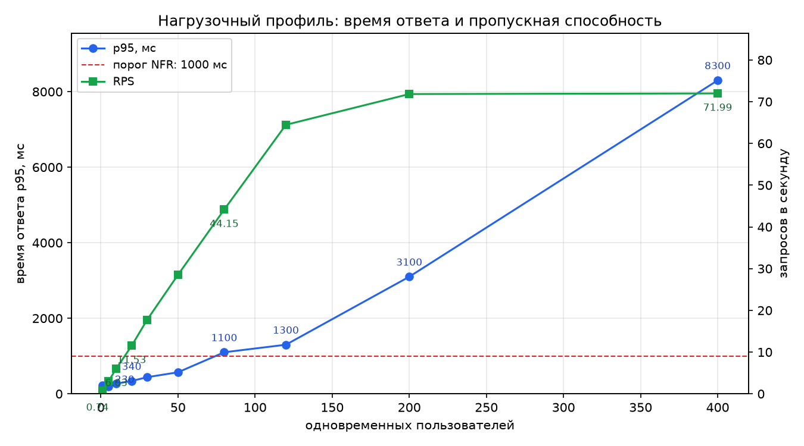

# Результаты нагрузочного тестирования (ЛР5 п. 2–3)

Профиль нагрузки и методика — в [`LOAD_PLAN.md`](LOAD_PLAN.md). Инструмент: Locust 2.47, `load/locustfile.py`. Точка — 20 с, все пользователи стартуют сразу.

## 1. Сводка по точкам

| Пользователи | Запросов | Ошибок | Доля ошибок, % | RPS | p50, мс | p95, мс | p99, мс | max, мс |
|---|---|---|---|---|---|---|---|---|
| 1 | 11 | 0 | 0.0 | 0.74 | 10 | 230 | 230 | 226 |
| 5 | 48 | 0 | 0.0 | 3.04 | 10 | 200 | 260 | 263 |
| 10 | 96 | 0 | 0.0 | 6.03 | 11 | 270 | 320 | 318 |
| 20 | 187 | 0 | 0.0 | 11.53 | 10 | 340 | 490 | 500 |
| 30 | 289 | 0 | 0.0 | 17.73 | 10 | 440 | 560 | 567 |
| 50 | 457 | 0 | 0.0 | 28.5 | 12 | 570 | 730 | 919 |
| 80 | 629 | 0 | 0.0 | 44.15 | 15 | 1100 | 1400 | 2209 |
| 120 | 963 | 0 | 0.0 | 64.46 | 18 | 1300 | 1900 | 2202 |
| 200 | 1169 | 0 | 0.0 | 71.83 | 1200 | 3100 | 4200 | 7710 |
| 400 | 1149 | 0 | 0.0 | 71.99 | 4000 | 8300 | 10000 | 14345 |

## 2. Проверка NFR-6 (20 пользователей)

| Критерий | Значение | Норма | Итог |
|---|---|---|---|
| p95 времени ответа | 340 мс | ≤ 1000 мс | ✅ |
| Доля ошибок | 0.0 % | ≤ 1 % | ✅ |
| Пропускная способность | 11.53 RPS | ≥ 10 RPS | ✅ |

**NFR-6 при 20 пользователях выполняется.**

Базовый прогон (1 пользователь): 0.74 RPS, p95 230 мс. При 20 пользователях RPS вырос в 15.6 раза, p95 вырос с 230 до 340 мс.

## 3. Точка деградации

**Точка деградации — 80 пользователей:** p95 = 1100 мс, доля ошибок 0.0 %.

Причина фиксации: p95 превысил 1 с.

До этой точки система работает предсказуемо, после — время ответа растёт быстрее нагрузки (очередь запросов к одному процессу).

**Точка отказа не достигнута.** Даже при 400 пользователях доля ошибок 0.0 %, но p95 = 8300 мс: система деградирует по времени ответа, а не отказывает. Пропускная способность при этом выходит на плато: 120 польз. — 64.46 RPS, 200 польз. — 71.83 RPS, 400 польз. — 71.99 RPS. Это и есть предел одного процесса: новые пользователи добавляют очередь, а не пропускную способность.

## 4. Гипотеза об узком месте

1. **Один процесс Flask dev-сервера.** Все запросы обслуживаются в одном процессе; при росте числа пользователей они встают в очередь, и p95 растёт быстрее RPS. Подтверждение: RPS растёт почти линейно только до 20–30 пользователей, дальше прирост замедляется, а p95 удваивается.
2. **SQLite и запись.** Перевод — единственная операция, которая пишет в БД; в профиле у неё вес 1, но именно она вызывает блокировки при конкурентных записях. Чтения (счета, история) ускоряются индексами, записи — нет.
3. **Дорогой вход.** `scrypt`-хэш пароля на `/api/v1/login` занимает сотни миллисекунд на запрос (видно по базовому прогону: p99 логина ~230 мс против 10–15 мс у чтения). Вход выполняется один раз на пользователя, поэтому на длинной нагрузке не доминирует, но при шторме входов становится первым ограничением.
4. **Генератор и приложение на одной машине.** Часть CPU забирает сам Locust; реальный предел выше, а точка деградации на отдельном сервере наступит позже.

## 5. Что улучшить

| Проблема | Мера | Ожидаемый эффект |
|---|---|---|
| Один процесс | запуск под gunicorn/waitress с несколькими воркерами | линейный рост RPS с числом ядер |
| Блокировки SQLite на записи | WAL-режим, короткие транзакции, вынести запись в очередь | меньше ошибок при конкурентных переводах |
| Дорогой вход | ограничить частоту входов, кэшировать токен, снизить параметры scrypt при массовом входе | p99 входа ниже |
| Долгие выборки истории | индексы по `sender_acc_id`/`receiver_acc_id` и `timestamp`, лимит по умолчанию | p95 истории стабильнее |

## 6. Ограничения достоверности

- Генератор нагрузки и приложение работают на одной машине (WSL2): цифры занижены.
- Dev-сервер Flask не предназначен для нагрузки; для боевых выводов нужен WSGI-сервер.
- SQLite — файловая БД без пула соединений; на PostgreSQL поведение будет другим.
